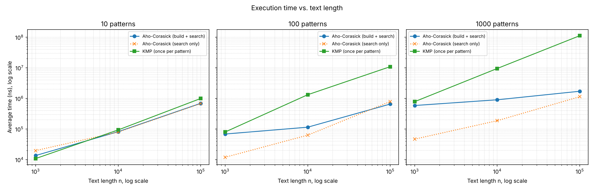
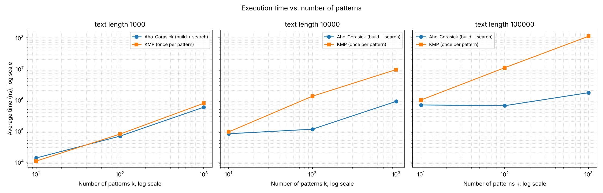
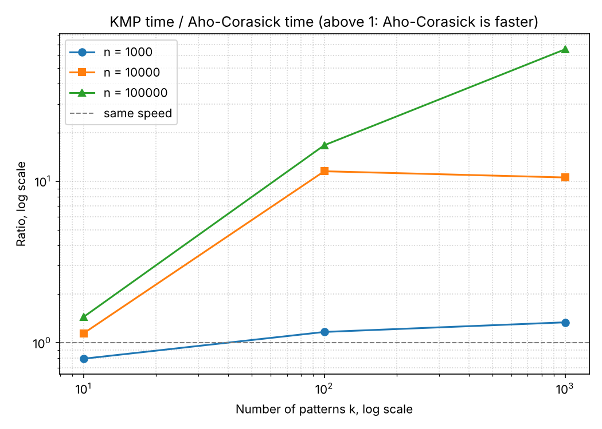

# Aho–Corasick: searching for many patterns at the same time

Java implementation of the **Aho–Corasick algorithm** (trie + failure links + output links), tests, and an experimental
comparison with **KMP run separately for every pattern**.

## Contents

1. [Overview](#1-overview)
2. [Implementation](#2-implementation)
3. [Complexity analysis](#3-complexity-analysis)
4. [Experimental setup](#4-experimental-setup)
5. [Results](#5-results)
6. [Discussion: Aho–Corasick vs. KMP per pattern](#6-discussion-ahocorasick-vs-kmp-per-pattern)
7. [Testing](#7-testing)
8. [Conclusion](#8-conclusion)

## How to build and run

```
# from the project root (aho-corasick/)
javac -d out $(find src -name "*.java")

java -cp out Main                 # small demo + all experiments (tables are saved to results/tables)
java -cp out Main demo            # only the demo (patterns he, she, his, hers in the text "ushers")
java -cp out Main experiments     # only the experiments
java -cp out tests.Tests          # all tests (prints PASS/FAIL, exit code 1 if something fails)

python3 results/plots/make_plots.py   # builds the plots from results/tables/results.csv (needs matplotlib)
```

In IntelliJ IDEA: mark `src` as *Sources Root*, then run `Main` or `tests.Tests`. No external libraries are needed for Java.
Python with matplotlib is used only for drawing the plots.

### Project structure

```
aho-corasick/
├── src/
│   ├── Main.java                  demo + running the experiments
│   ├── ahocorasick/               AhoCorasick, Match, SearchResult
│   ├── kmp/                       KMP (one pattern; used for the comparison)
│   ├── experiments/               Experiments, StringGenerator
│   └── tests/                     Tests
├── results/
│   ├── tables/                    results.csv, results.md, test_output.txt
│   └── plots/                     3 plots + make_plots.py
└── README.md
```

## 1. Overview

**Problem.** We have a text of length `n` and `k` patterns, and we want **all occurrences of all patterns**.
The simple way is to run a single-pattern algorithm (for example KMP) `k` times, which reads the text `k` times.
The Aho–Corasick algorithm reads the text **only once**, whatever the number of patterns is.

**Main ideas.**

- **Trie.** All patterns are stored in one prefix tree. Patterns that start the same way share the same path. Every node
  corresponds to a prefix of some pattern, and a node is marked if a whole pattern ends there.
- **Failure links.** The failure link of a node with string `s` points to the node of the *longest proper suffix of `s`
  that is also a node of the trie* (so also a prefix of some pattern). When the next text character does not fit,
  we do not start again from the root: we move along the failure link, and everything that was matched and is still useful is kept.
  It is the same idea as the `lps` table in KMP, but for a whole trie, not for one string. (For one pattern the trie is a path
  and the failure links are exactly the KMP `lps` values.)
- **Output (dictionary) links.** One pattern can be a suffix of another one (for example `he` is a suffix of `she`).
  Then at the node `she` we must report `she` **and** `he`. The output link of a node points to the nearest node on its
  failure chain where a pattern ends, so we jump only between nodes that really give a match and we do not walk over the
  other nodes of the failure chain.

**Example** (patterns `he, she, his, hers`; the output of `java -cp out Main demo`):

| Node | Failure link | Remark |
|---|---|---|
| `h` | root | |
| `he` | root | end of pattern `he` |
| `s` | root | |
| `sh` | `h` | the suffix `h` is a prefix of `he`, `his`, `hers` |
| `she` | `he` | end of pattern `she`; output link → `he` |
| `hi` | root | |
| `his` | `s` | end of pattern `his` |
| `her` | root | |
| `hers` | `s` | end of pattern `hers` |

In the text `ushers` the algorithm finds `she` at 1, `he` at 2 and `hers` at 2. At the node `she` (after reading `ushe`) both
`she` and `he` are reported thanks to the output link.

## 2. Implementation

### Class `AhoCorasick`

**Data.** The trie is stored in arrays (not in node objects):

- `next[node * sigma + c]`: the child of `node` for the character with index `c` (or −1), `sigma` = alphabet size;
- `fail[node]`: failure link; `dictLink[node]`: output link (0 = none, because the root is never the end of a pattern);
- `isEnd[node]` and `endIds[node]`: whether and which patterns end in the node (equal patterns are allowed and are all reported);
- `parent`, `parentChar`: only for printing the trie and for the tests.

**1. Trie construction (`buildTrie`).** For every pattern we walk from the root, creating missing nodes, and mark the last node.
Time O(M) where `M` is the total length of all patterns.

**2. Failure links (`buildFailureLinks`).** BFS from the root, level by level.
Nodes at depth 1 get the root as failure link. For a node `v` which is the child of `u` by the character `c`:

```
f = fail[u]
while f is not the root and f has no child by c:  f = fail[f]
fail[v] = (f has a child by c) ? that child : root
```

Why this is right: the longest proper suffix of `string(u) + c` is a suffix of `string(u)` followed by `c`. The candidates for
this suffix are exactly the nodes on the failure chain of `u` (from the longest to the shortest). We take the first one that has an edge for `c`.
We need BFS because the failure link only goes to a node with smaller depth, which has to be finished before.

**3. Output links.** Also in the BFS: `dictLink[v] = fail[v]` if a pattern ends in `fail[v]`, otherwise `dictLink[fail[v]]`.
So `dictLink[v]` is the nearest node on the failure chain of `v` that is the end of a pattern.

**4. Search (`search`).** We keep the current node `state` (the longest suffix of the text read so far that is a prefix of some pattern):

```
for every character c of the text:
    while state is not the root and state has no child by c:  state = fail[state]
    if state has a child by c:  state = that child
    node = state if a pattern ends in state, otherwise dictLink[state]
    while node is not the root:
        report all patterns that end in node (start = i - length + 1)
        node = dictLink[node]
```

The result contains all occurrences (also overlapping ones and patterns that are inside other patterns), ordered by the end position.
The search also counts the failure links followed (`failureSteps`) for the experiments.

### Assumptions and decisions

- The alphabet is given in the constructor (in the experiments `a–z`). Patterns must only use characters of the alphabet.
  A character of the text which is not in the alphabet can not be in any pattern, so the search simply goes back to the root.
- **Empty patterns** and patterns with characters outside the alphabet are **rejected** with `IllegalArgumentException`.
  An empty list of patterns is allowed (no matches). **Equal patterns** are allowed, each of them is reported with its own index.
- Occurrences are returned as `Match(patternIndex, start)` with a 0-based start position.
- The edges of the trie are stored in an array of size `sigma` per node. This is fast but uses `O(M·sigma)` memory (see section 3).
- Implementation notes from development: my first version created a table of 65 536 numbers (all possible `char` values) for every automaton,
  and it dominated the building time for small pattern sets (about 20 µs for 10 patterns); now the table is only as big as the largest character of the alphabet.
  I also replaced a list of lists by plain arrays (`isEnd`, `endIds`) for the search, which did not change the results noticeably but is simpler for the JVM.
- **KMP** (`kmp.KMP`) is the same implementation as in my previous assignment (an empty pattern gives no matches). For the comparison it is run
  once for every pattern: `KMP.searchAll`.

## 3. Complexity analysis

Notation: `n` = text length, `k` = number of patterns, `M` = sum of the lengths of all patterns, `sigma` = alphabet size,
`z` = number of reported occurrences, `m_i` = length of the i-th pattern.

| Part | Time | Explanation |
|---|---|---|
| Trie construction | O(M) | one step for every character of every pattern |
| Failure and output links | O(M) amortized for the loops over failure links, plus O(M·sigma) in my implementation | For one pattern, the depth of the failure link grows by at most 1 for every character, and every step along a failure link makes it smaller, so the number of steps along the chain is at most the pattern length. Summed over all patterns: O(M). My BFS also looks at all `sigma` characters of every node, which gives O(M·sigma); with a map or a linked list for the edges (or for a constant alphabet) it is O(M). |
| **Search** | **O(n + z)** | The depth of the current node grows by at most 1 for each text character, and each failure step makes it smaller, so there are at most `n` failure steps (in the experiments: 30 651 for n = 100 000 and k = 10; the counter `failureSteps` in `Tests` checks `<= n`). Every output link that we follow reports at least one match, so reporting costs O(z) in total. |
| **Total** | **O(M·sigma + n + z)** (O(M + n + z) with maps) | |

**Space.** The trie has at most `M + 1` nodes. With the array `next` the memory is **O(M·sigma)** (for the experiment with
1000 patterns the trie has about 7 000 nodes, so `7 000 · 26` ints ≈ 0.7 MB); with maps it would be O(M). The arrays `fail`, `dictLink`, `isEnd`, `endIds` need O(M). The output of
the search needs O(z).

**KMP run separately for each pattern.** One run costs O(m_i) for the `lps` table and O(n) for the search, so all `k` patterns cost
**O(k·n + M)** time. The memory is only O(max m_i), because the `lps` table can be thrown away after each pattern.

| | Time | Memory |
|---|---|---|
| Aho–Corasick | O(M·sigma + n + z) | O(M·sigma) |
| KMP, once per pattern | O(k·n + M) | O(max m_i) |

The important difference: in Aho–Corasick the text length `n` and the number of patterns `k` are **added** (the number of patterns only
matters through the construction cost `M`), and with KMP they are **multiplied**.

**Why Aho–Corasick is suitable for many patterns.** The trie stores the shared prefixes of all patterns only once, and the failure links make it
possible to track *all patterns at the same time* with one pointer: the current node represents the longest suffix of the text that is a prefix of
some pattern, and by following failure links we also get all shorter suffixes, which are exactly the candidates for other patterns. So the text is read once, and no character is looked at again.

*Theoretical complexity and measured time are different things.* The table above counts steps and ignores constants, memory access and the JVM, so the
measured times in section 5 are only compared with it by trend.

## 4. Experimental setup

| Parameter | Values |
|---|---|
| Number of patterns `k` | 10, 100, 1000 |
| Text length `n` | 1 000, 10 000, 100 000 |
| Alphabet | `a`–`z` (26 letters) |
| Random seed | 42 for the text; the patterns of every `k` use seed 42 + k |
| Pattern length | random from 5 to 12 |
| Patterns | all `k` patterns are **different**: half are cut out of the text (so they really occur), half are random strings (most of them do not occur) |

- The 9 combinations (3 values of `k` × 3 values of `n`) were all tested. The same text and the same pattern list are used for Aho–Corasick and for KMP.
- **Timing:** `System.nanoTime()` before and after one run; every task is run **5 times**, and the **average** is reported (the 5 separate times are in
  `results/tables/results.csv`).
- **Four tasks are measured:** (1) Aho–Corasick *build + search*, the fair comparison with KMP, because KMP also builds its `lps` tables inside its time;
  (2) Aho–Corasick *build only*; (3) Aho–Corasick *search only* with an already built automaton; (4) *KMP once per pattern* (all `k` runs together).
- **Not in the timed region:** generation of the text and patterns, the check that Aho–Corasick and KMP found exactly the same occurrences (the program stops with an error
  if they differ), console output and writing of files.
- **Warm-up:** the JVM is slow in the beginning (interpreter and JIT), so the whole experiment is run once and thrown away, and every task is also run for about 100 ms before it is measured.
- **Operation counts.** Aho–Corasick: characters inserted into the trie + failure links followed during construction + characters of the text + failure links followed in the search.
  KMP: character comparisons in all searches and all `lps` tables together. These are different kinds of operations, so the counts show the *growth*, not the exact speed.

## 5. Results

Full table of all 36 measurements (the times of the 5 runs for each row are in `results/tables/results.csv`):

### All measurements

| Patterns k | Text length n | Algorithm | Avg time (ns) | Operations | Matches | Trie nodes |
|---:|---:|---|---:|---:|---:|---:|
| 10 | 1000 | Aho-Corasick (build + search) | 13,628 | 1306 | 5 | 70 |
| 10 | 1000 | Aho-Corasick (build only) | 15,437 | 86 | - | 70 |
| 10 | 1000 | Aho-Corasick (search only) | 19,788 | 1220 | 5 | - |
| 10 | 1000 | KMP (once per pattern) | 10,844 | 10436 | 5 | - |
| 100 | 1000 | Aho-Corasick (build + search) | 68,681 | 3209 | 50 | 797 |
| 100 | 1000 | Aho-Corasick (build only) | 55,824 | 1480 | - | 797 |
| 100 | 1000 | Aho-Corasick (search only) | 11,971 | 1729 | 50 | - |
| 100 | 1000 | KMP (once per pattern) | 80,021 | 104651 | 50 | - |
| 1000 | 1000 | Aho-Corasick (build + search) | 587,154 | 13301 | 500 | 6502 |
| 1000 | 1000 | Aho-Corasick (build only) | 545,720 | 11951 | - | 6502 |
| 1000 | 1000 | Aho-Corasick (search only) | 46,877 | 1350 | 500 | - |
| 1000 | 1000 | KMP (once per pattern) | 784,610 | 1045810 | 500 | - |
| 10 | 10000 | Aho-Corasick (build + search) | 81,940 | 13549 | 5 | 75 |
| 10 | 10000 | Aho-Corasick (build only) | 4,973 | 98 | - | 75 |
| 10 | 10000 | Aho-Corasick (search only) | 79,766 | 13451 | 5 | - |
| 10 | 10000 | KMP (once per pattern) | 93,534 | 103895 | 5 | - |
| 100 | 10000 | Aho-Corasick (build + search) | 114,900 | 21165 | 50 | 804 |
| 100 | 10000 | Aho-Corasick (build only) | 45,438 | 1531 | - | 804 |
| 100 | 10000 | Aho-Corasick (search only) | 63,093 | 19634 | 50 | - |
| 100 | 10000 | KMP (once per pattern) | 1,321,630 | 1039315 | 50 | - |
| 1000 | 10000 | Aho-Corasick (build + search) | 903,300 | 31121 | 500 | 6907 |
| 1000 | 10000 | Aho-Corasick (build only) | 715,657 | 13514 | - | 6907 |
| 1000 | 10000 | Aho-Corasick (search only) | 187,516 | 17607 | 500 | - |
| 1000 | 10000 | KMP (once per pattern) | 9,512,305 | 10391783 | 500 | - |
| 10 | 100000 | Aho-Corasick (build + search) | 692,524 | 130748 | 5 | 74 |
| 10 | 100000 | Aho-Corasick (build only) | 4,692 | 97 | - | 74 |
| 10 | 100000 | Aho-Corasick (search only) | 679,102 | 130651 | 5 | - |
| 10 | 100000 | KMP (once per pattern) | 998,194 | 1038370 | 5 | - |
| 100 | 100000 | Aho-Corasick (build + search) | 655,522 | 196895 | 50 | 805 |
| 100 | 100000 | Aho-Corasick (build only) | 60,144 | 1534 | - | 805 |
| 100 | 100000 | Aho-Corasick (search only) | 791,245 | 195361 | 50 | - |
| 100 | 100000 | KMP (once per pattern) | 10,923,555 | 10386627 | 50 | - |
| 1000 | 100000 | Aho-Corasick (build + search) | 1,715,882 | 209880 | 501 | 6963 |
| 1000 | 100000 | Aho-Corasick (build only) | 656,740 | 13925 | - | 6963 |
| 1000 | 100000 | Aho-Corasick (search only) | 1,140,679 | 195955 | 501 | - |
| 1000 | 100000 | KMP (once per pattern) | 112,134,652 | 103854037 | 501 | - |

### KMP time divided by Aho-Corasick (build + search) time

Values above 1 mean that Aho-Corasick is faster.

| Patterns k \ Text length n | 1000 | 10000 | 100000 |
|---:|---:|---:|---:|
| 10 | 0.80 | 1.14 | 1.44 |
| 100 | 1.17 | 11.50 | 16.66 |
| 1000 | 1.34 | 10.53 | 65.35 |

### Plots

**1. Execution time vs. text length** (one panel for every number of patterns, log–log scale)



**2. Execution time vs. number of patterns** (one panel for every text length)



**3. How many times faster is Aho–Corasick (KMP time / Aho–Corasick time)**



## 6. Discussion: Aho–Corasick vs. KMP per pattern

**KMP time grows linearly with the number of patterns, Aho–Corasick time does not.** For the longest text (n = 100 000) KMP needed 1.0 ms, 10.9 ms and 112 ms
for 10, 100 and 1000 patterns, i.e. about 10× more for 10× more patterns, exactly as O(k·n) predicts. The number of character
comparisons shows the same: 1.04·10⁶, 1.04·10⁷ and 1.04·10⁸. Aho–Corasick (build + search) needed 0.69 ms, 0.66 ms and 1.72 ms
for the same cases: almost the same for 10 and 100 patterns and only about 2.6× more for 1000 patterns. For k = 1000 and n = 100 000
the speed-up is about **65×** in time (112 ms vs. 1.7 ms) and about **495×** in the number of operations (103 854 037 vs. 209 880).

**Search time depends on the text, not on the patterns.** The operations of the Aho–Corasick search are `n` + the number of failure steps, so they stay at 130 651, 195 361 and 195 955
for n = 100 000 and k = 10, 100, 1000. The failure steps are always less than `n` (30 651 / 95 361 / 95 955), as proven in section 3. The search-only time
grows roughly linearly with `n` (for 1000 patterns: 47 µs, 188 µs, 1.14 ms).

**The construction cost grows with the total length of the patterns and does not depend on the text.** The build-only times were about 5 µs (one measurement gave 15 µs, probably noise), 45–60 µs and 550–720 µs
for 10, 100 and 1000 patterns (about 75, 800 and 6 500–7 000 trie nodes), i.e. roughly proportional to `M`. For a short text this matters: for n = 1 000 the speed-up of Aho–Corasick
is only 0.8× (k = 10), 1.2× (k = 100) and 1.3× (k = 1000), because building the automaton for 1000 patterns costs about as much as the whole KMP work
on a text of 1 000 characters. When the text is longer, the construction is a small part of the total time (about 38% for k = 1000 and n = 100 000), and the speed-up grows (11–17× for k = 100, n ≥ 10 000).

**For few patterns there is almost no advantage.** For k = 10 the two algorithms are about equal (ratio 0.8 to 1.4, which is inside the noise of the measurement). Even
though KMP makes about 8× more operations for k = 10 and n = 100 000 (1.04·10⁶ vs. 1.3·10⁵), the times differ by only about 1.4×. A probable reason is that one Aho–Corasick step
is more expensive than one KMP step: it is a chain of dependent memory accesses (`state` → `next[...]` → new `state`), and following failure links on random text gives branches that are difficult for the processor to predict.
I did not measure this separately, so it is only my explanation. For one pattern the trie is a path and the algorithm is KMP with a more complicated structure, so there is no reason to use it.

**Measurement noise.** Every number is the average of only 5 runs, and runs of tens of microseconds are very sensitive to garbage collection and the JIT compiler. For example, in some
rows the *search-only* time is bigger than the *build + search* time (k = 10, n = 1 000: 19.8 µs vs. 13.6 µs), which is impossible in theory, and for k = 100, n = 100 000
build + search (656 µs) is less than search only (791 µs). So differences smaller than about 30–50% should not be trusted. The big differences (10–65× for many patterns and long texts) are far above this noise.

### Advantages and limitations

| | Aho–Corasick | KMP run separately for each pattern |
|---|---|---|
| **Advantages** | The text is read once: O(n + z) search after the construction, independent of `k`. Very good for many patterns (here 65× faster for 1000 patterns). Finds overlapping patterns and patterns that are inside other patterns. The automaton can be built once and used for many texts. Works as a stream: it needs only the current node. | Very simple to write and to explain. Needs only O(m) memory for one pattern. No construction step shared between the patterns, so it is good when `k` is 1 or very small. Patterns can be added, removed or processed independently (and in parallel). |
| **Limitations** | More complicated code (trie, BFS, two kinds of links). Memory O(M·sigma) with array edges (can be reduced with maps, but then it is slower). All patterns must be known before the search; adding a pattern means rebuilding (or a more complicated dynamic version). The construction cost is large for short texts. The number of reported matches `z` can be big (up to about `n·k`), and it is a part of the running time. | Reads the text `k` times: O(k·n), so it does not scale to thousands of patterns (112 ms vs. 1.7 ms here). Repeats the same work for patterns with common prefixes. |

## 7. Testing

Tests are in `src/tests/Tests.java` (no JUnit; a small `check(name, condition)` method prints PASS/FAIL). Run: `java -cp out tests.Tests`.
The output of my run is in `results/tables/test_output.txt`: **43 checks, all passed.**
Every search result is compared with a very simple brute-force check (every pattern at every position).

| What is tested | Examples |
|---|---|
| Trie and failure links (checked by hand) | the trie of `he, she, his, hers` has 10 nodes (with the root); `fail(sh) = h`, `fail(she) = he`, `fail(hers) = s`, `fail(his) = s`, the others point to the root; output link of `she` is `he`; chain `a, aa, aaa`: `fail(aaa) = aa`, `fail(aa) = a` |
| Different numbers and positions of patterns | single pattern; `he, she, his, hers` in `ushers` → `she@1, he@2, hers@2`; patterns `a, ab, bab, bc, bca, c, caa` in `abccab`; patterns at the beginning, in the middle and at the end; several different patterns in one text |
| Patterns that contain each other | `a, aa, aaa` in `aaaa` (9 occurrences, found through the output links); pattern is a prefix of another (`ab`, `abc`); pattern is a suffix of another (`bc`, `abc`); overlapping occurrences (`aba` in `abababa`); a case where a failure link is really needed (`abcd`, `bce` in `abce`) |
| Special cases | no pattern occurs; empty text; empty list of patterns; pattern equal to the text; pattern longer than the text; one-character patterns; the same pattern given twice; a text character outside the alphabet; empty pattern, pattern outside the alphabet and a bad alphabet are rejected |
| Properties | the number of failure steps in the search is never bigger than the text length; the generator really creates 1000 different patterns |
| Random cross-checks | 500 random small cases with alphabet `ab` (many overlaps, duplicate patterns allowed) == brute force; 10 texts of length 5000 with 50 patterns each: for every pattern the positions are the same as the positions from KMP |

In addition, the experiment program compares Aho–Corasick with KMP for **every one of the 9 test cases of the experiments** (before measuring) and stops with an error if the occurrences differ.

## 8. Conclusion

- Aho–Corasick is the right tool when there are **many patterns and a long text**: it reads the text once (O(n + z)), and the number of patterns only changes the one-time
  construction cost. In my experiments with 1000 patterns and a text of 100 000 characters it was about 65× faster than running KMP for every pattern.
- Running **KMP separately** costs O(k·n), so its time grows linearly with the number of patterns. It is simpler, needs little memory, and is a good choice for **one or a few patterns** or for short texts;
  for 10 patterns the two approaches were about equal in my measurements.
- The price of Aho–Corasick is the **memory** for the automaton (O(M·sigma) with array edges), a more complicated implementation, the need to know all patterns in advance,
  and a construction cost that can be larger than the search itself for short texts (n = 1 000).
- The experiments agree with the theory by trend (KMP linear in `k`, Aho–Corasick nearly independent of `k`), but small differences in time are inside the noise of 5-run averages on one computer, so only the big differences should be trusted.
